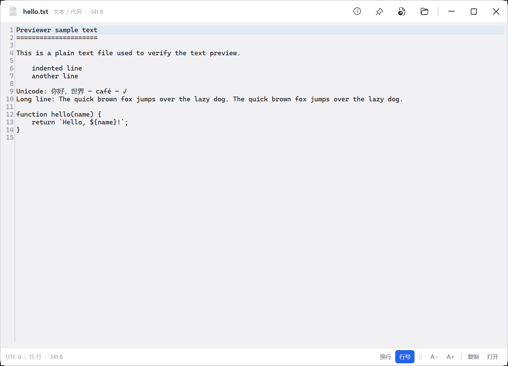

# Previewer for Windows

Select a file or folder in File Explorer and press **Space** to preview it. Press
**Space** or **Esc** to close the preview. Previewer supports images, PDF, Office
documents, source code, archives, audio and video.

## Download and activate

Previewer costs **US$1.99 as a one-time purchase**. Download the Windows x64
package from the [releases page](https://github.com/yuan-xin-9997/Previewer/releases).
The package requires Windows 10 or 11 and Microsoft Edge WebView2 Runtime.

Extract the ZIP and run `Previewer.exe`. Open **Settings → License** and paste the
activation code after checkout. Save the code for future installations. File
previews run locally and work offline after activation.

The [Previewer store](https://previewer.yuan-xin.top/) is the purchase and activation
code delivery site. Check the release notes for sales availability.

Contact [support@yuan-xin.top](mailto:support@yuan-xin.top) for help.
